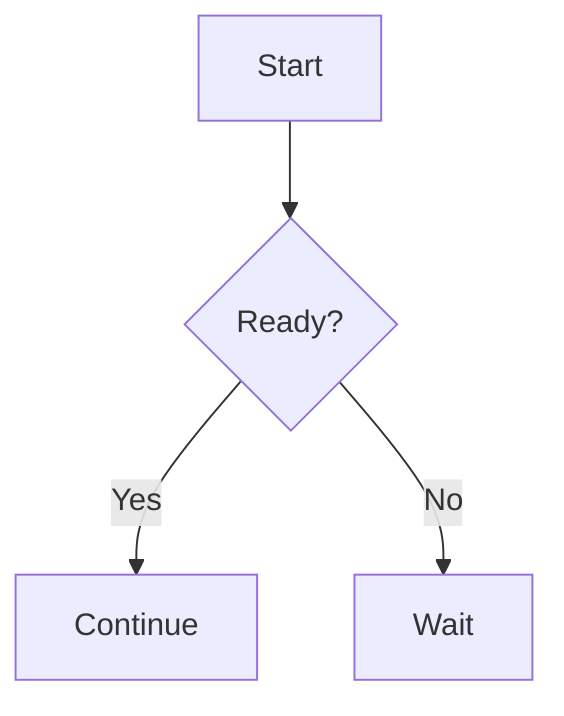

# Markdown Viewer

A small, dependency-free Chrome extension that turns `.md` and `.markdown` documents into readable pages.

## Install

1. Open `chrome://extensions` in Chrome.
2. Turn on **Developer mode**.
3. Select **Load unpacked** and choose this folder.
4. To render local files, open the extension’s **Details** page and enable **Allow access to file URLs**.

## Use

Open a web or local `.md` / `.markdown` file. The extension formats it automatically. Other pages are left as they are.

The renderer supports headings, paragraphs, emphasis, inline and fenced code, links, images, lists, blockquotes, horizontal rules, and basic tables. Fenced Mermaid `graph` / `flowchart` blocks render common directed nodes and arrows, and `sequenceDiagram` blocks render participants, messages, notes, and common control sections locally as SVG. Unsupported Mermaid syntax stays visible as code. It has no remote dependencies and treats raw HTML in Markdown as text.

Example:

